# Guida all'uso del sito WeRo

Per chi aggiorna il sito ogni giorno: testi, immagini, progetti, report, partner. Non serve conoscere il codice.

Gli screenshot vengono dal sito di prova (WordPress Playground) e sono nella cartella `guida/`. Sul sito online alcune schermate possono cambiare leggermente, per esempio gli avvisi dei plugin collegati.

**Indice**
1. [Accesso](#1-accesso)
2. [Modificare una pagina](#2-modificare-una-pagina)
3. [Creare una pagina nuova dai pattern](#3-creare-una-pagina-nuova-dai-pattern)
4. [Header, footer e menu](#4-header-footer-e-menu)
5. [Colori, font e logo](#5-colori-font-e-logo)
6. [Contenuti strutturati: progetti, report, partner, persone, mondi](#6-contenuti-strutturati)
7. [Impostazioni del sito (Impostazioni › WeRo)](#7-impostazioni-del-sito)
8. [Yoast SEO](#8-yoast-seo)
9. [Immagini](#9-immagini)
10. [Modulo contatti ed email](#10-modulo-contatti-ed-email)
11. [Cookie](#11-cookie)
12. [Cosa non fare](#12-cosa-non-fare)
13. [Aggiornamenti e backup](#13-aggiornamenti-e-backup)
14. [Domande frequenti](#14-domande-frequenti)

---

## 1. Accesso

- Indirizzo: **https://we-ro.it/wp-admin/**. Inserisci nome utente (o email) e password.
- Password dimenticata: dalla stessa pagina, “Password dimenticata?”.
- Ruoli (D6):
  - **Amministratore**: tutto, comprese impostazioni, plugin e struttura;
  - **Editor**: testi, immagini, progetti, report, partner. Non può cambiare header, footer, template e struttura della home: può cambiarne i testi e le immagini, ma non spostare o cancellare le sezioni.
- Per invitare una persona: Utenti › Aggiungi nuovo utente, ruolo **Editor**.

Dopo l'accesso vedi la **Bacheca**. Nel menu a sinistra trovi le voci del sito: **Progetti**, **Report**, **Partner**, **Persone**, oltre a Pagine, Media, **Contact** (il modulo, Contact Form 7), **Cookiez** (banner dei cookie), Yoast SEO e Impostazioni.

La voce **Elementor** nel menu non è il page builder: la aggiungono Site Mailer, Image Optimizer e Cookie Consent, che usano un account Elementor per il collegamento. Non serve aprirla.

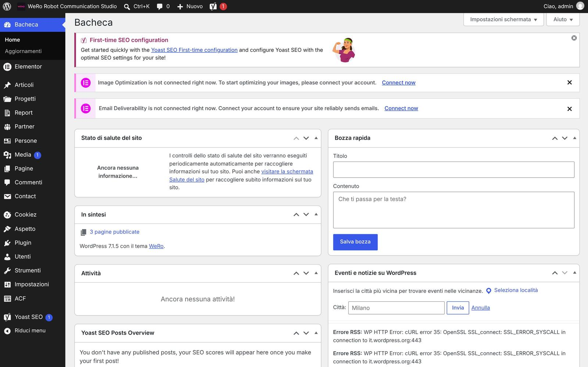

Gli avvisi rosa “not connected” di Image Optimization e Site Mailer spariscono quando i plugin vengono collegati sul sito online.

## 2. Modificare una pagina

1. Vai in **Pagine** e passa sopra il titolo della pagina, poi clicca **Modifica**. Per la home: Pagine › Home. In alternativa, dal sito, clicca **Modifica pagina** nella barra in alto.
2. Si apre l'**editor a blocchi**: ogni parte della pagina (titolo, paragrafo, immagine, pulsante, sezione) è un blocco.
3. Clicca un testo e scrivi. Per un'immagine: selezionala, poi **Sostituisci** nella barra del blocco.
4. Il pannello a destra (icona del quadrato diviso, in alto a destra) mostra le impostazioni del blocco selezionato: stile, colori, spazi, link.
5. **Salva** in alto a destra. Le modifiche sono online subito.

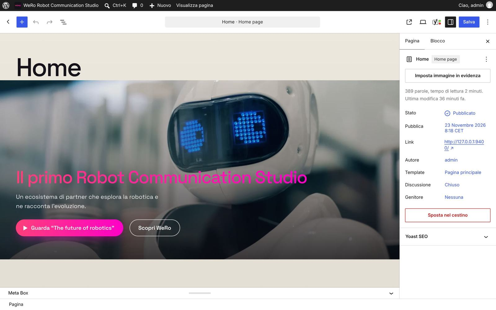

Il titolo “Home” in cima si vede solo nell'editor: serve a riconoscere la pagina, sul sito non compare.

**Vista elenco.** L'icona con le tre righe in alto a sinistra apre la struttura della pagina. È il modo più semplice per selezionare un blocco dentro un altro, per esempio una card dentro la sezione Mondi.

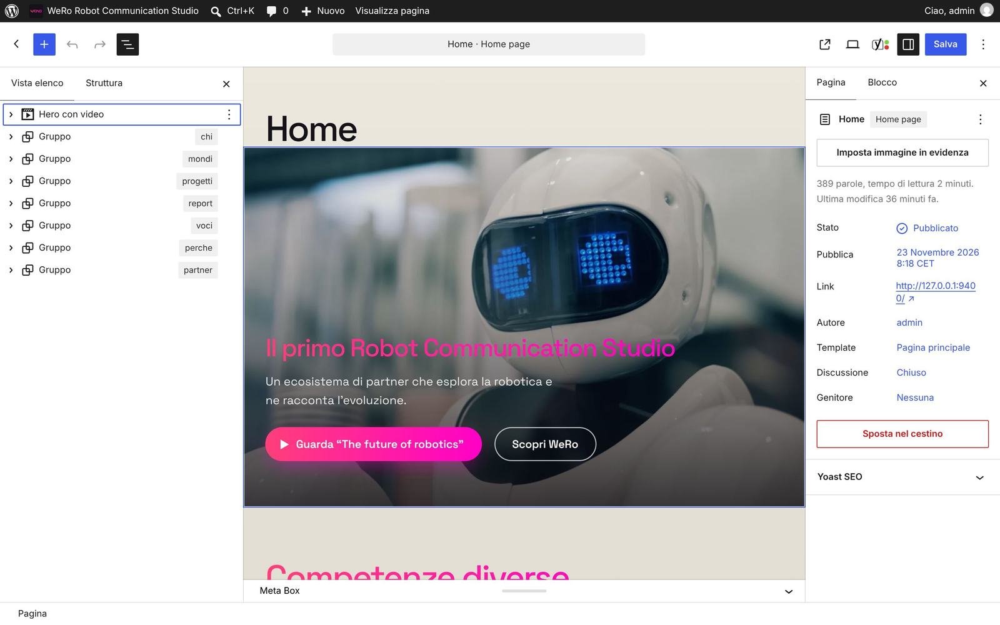

**Le sezioni della home**
| Sezione | Come si modifica |
|---|---|
| Hero (titolo, testo, pulsanti, video) | Testi direttamente; video e copertina nel pannello a destra del blocco “Hero con video” |
| I tre mondi | Ogni card è un Gruppo: immagine, titolo, testo e pulsante si cambiano direttamente. Il link “Vedi i progetti” ha la forma `#progetti?mondo=robotics-intelligence` (o `conversation-events`, `language-design`) e filtra la sfera. |
| Progetti (sfera) | Non si modifica qui: legge i **Progetti** (sezione 6) |
| Perché / Chi siamo | Testi e immagini direttamente |
| Report (timeline) | Legge i **Report** (sezione 6). Il pulsante “Scarica il report” porta alla pagina **Scarica i report** |
| Partner e collaboratori | Leggono i **Partner** (sezione 6) |
| Diventa partner | Testi direttamente; il modulo si modifica in Contact (sezione 10) |

**Aggiungere una card** ai Mondi: seleziona una card dalla vista elenco › menu a tre puntini › **Duplica**, poi cambia testi, immagine e link.

**Annullare.** `Ctrl+Z` (Mac `Cmd+Z`) annulla l'ultima modifica. Per tornare a una versione salvata: pannello a destra › **Revisioni**.

## 3. Creare una pagina nuova dai pattern

I **pattern** sono sezioni già pronte con lo stile del sito.

1. **Pagine › Aggiungi nuova pagina.**
2. Si apre una pagina vuota con lo sfondo e i font del sito.
3. Scrivi il titolo.
4. Per aggiungere sezioni: clicca **+** in alto a sinistra › scheda **Pattern** › categoria:
   - **WeRo – Home**: le sezioni della home (mondi, perché, chi siamo, partner…);
   - **WeRo – Sezioni comuni**: blocchi racconto testo + immagine, galleria foto, fascia dei collaboratori;
   - **WeRo – Progetti**: contenuti di partenza dei 4 formati di progetto.
5. Clicca il pattern per inserirlo, poi sostituisci testi e immagini.
6. **Pubblica.** Per metterla nel menu vedi la sezione 4.

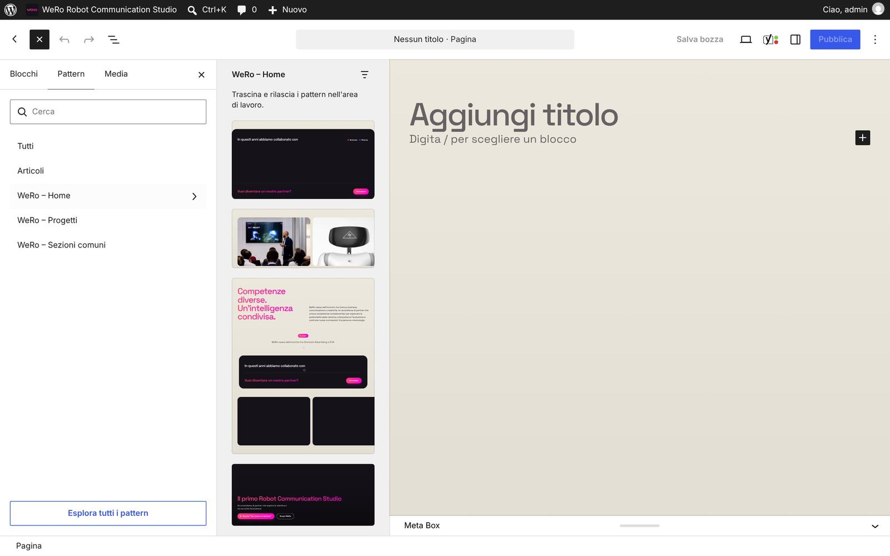

**Stili dei blocchi.** Molti blocchi hanno stili già pronti nel pannello a destra › **Stili**. Usa quelli invece di colori a mano:

| Blocco | Stili |
|---|---|
| Pulsante | Predefinito (sfumatura), Scuro, Contorno, Contorno chiaro, Chip |
| Gruppo | Card chiara, Pannello scuro, Vetro, Mondi |
| Titolo / Paragrafo | Sfumatura; il Paragrafo ha anche Bollino |
| Immagine / Video | Arrotondata grande |
| Galleria | A scorrimento |

## 4. Header, footer e menu

Sono parti comuni a tutte le pagine e si modificano dall'**Editor del sito** (solo amministratori).

1. **Aspetto › Editor › Pattern › Parti del template** (o dal sito: **Modifica sito**).
2. Scegli **Header** o **Footer** e clicca sull'anteprima per modificarla.
3. Modifica come in una pagina e **Salva**.

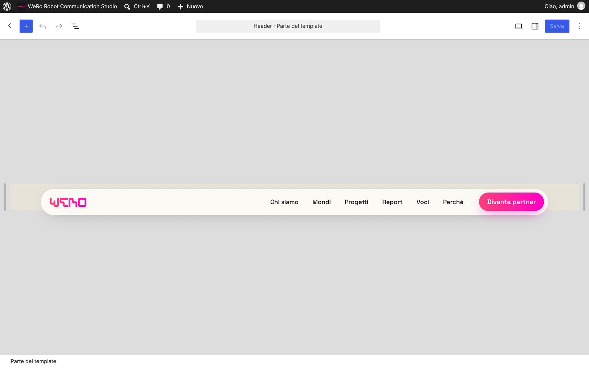

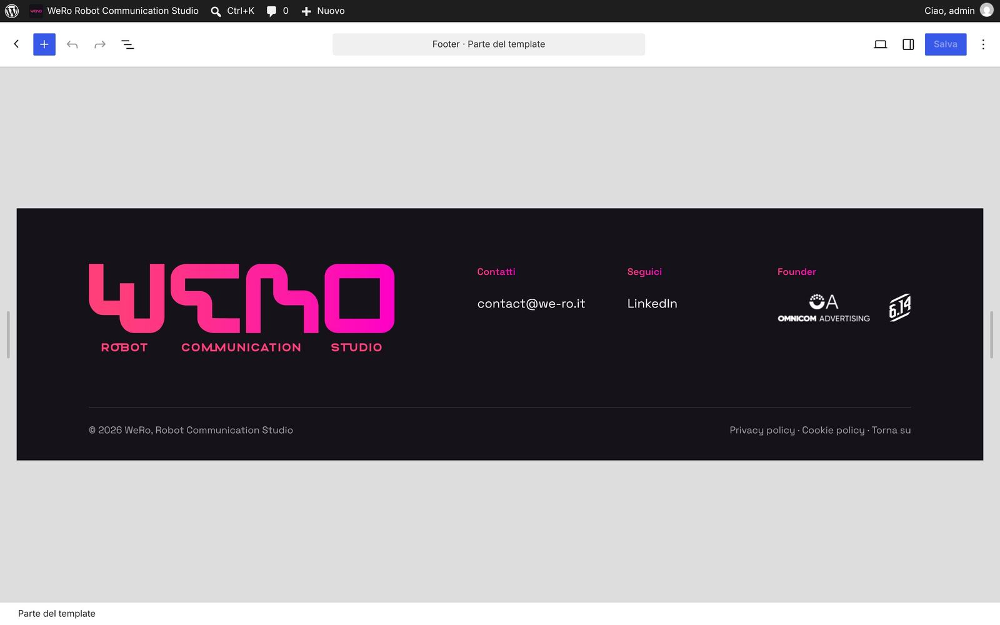

**Email, LinkedIn e copyright del footer** non si scrivono nel footer: arrivano da **Impostazioni › WeRo** (sezione 7). Nell'editor si vedono con il valore vero, ma per cambiarli usa le Impostazioni. Così lo stesso dato resta uguale anche nei dati per Google.

**Menu**
1. **Aspetto › Editor › Navigazione.**
2. Scegli il menu “Menu principale”.
3. Le voci puntano alle sezioni della home (`/#mondi`, `/#progetti`, `/#report`, `/#partner`) e alle pagine. Clicca **+** per aggiungere una voce. Per spostarla, trascinala; per toglierla, usa i tre puntini › Elimina.
4. **Salva.**

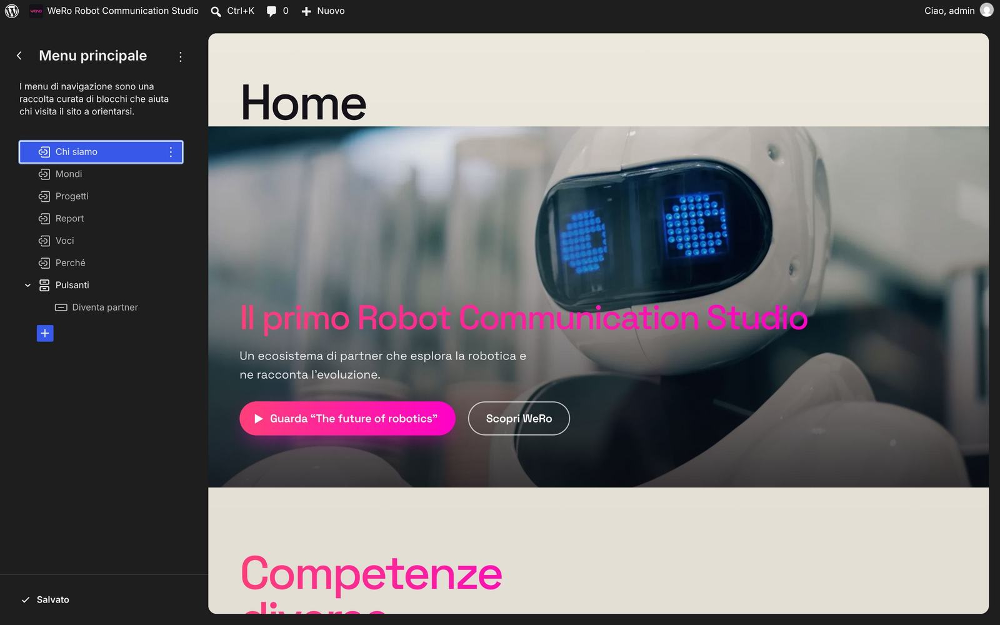

Sotto i 1080px di larghezza il menu diventa automaticamente una tendina.

## 5. Colori, font e logo

**Colori e font del sito** (solo amministratori). Due strade, con lo stesso effetto su tutto il sito:
- **Impostazioni › WeRo › Aspetto:** rosa, magenta, inchiostro, fondo e font. Lasciando vuoto si usano quelli del tema. È la strada consigliata.
- **Aspetto › Editor › Stili:** gli Stili globali di WordPress. Permettono di cambiare anche dimensioni dei testi, spazi e stile dei singoli blocchi.

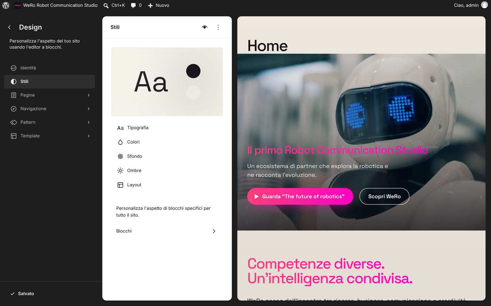

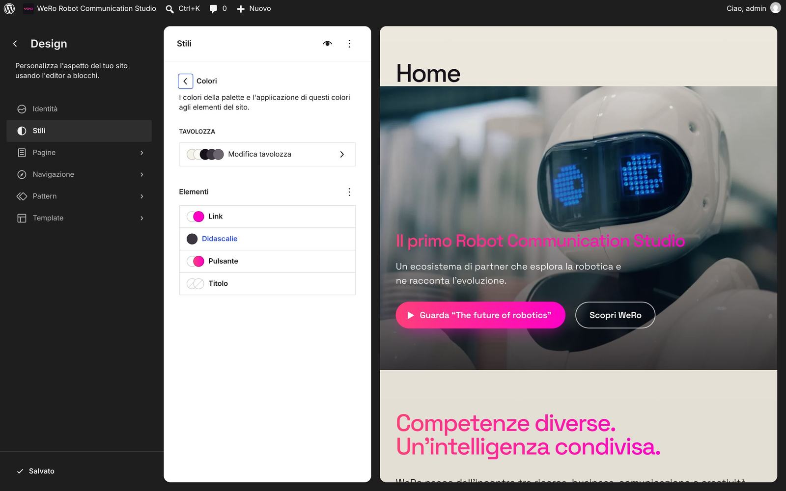

I colori della palette (Carta, Inchiostro, Rosa, Magenta, Viola ricerca…) sono quelli che compaiono quando scegli un colore in un blocco. Usa sempre questi: se un giorno cambia un colore della palette, cambia ovunque.

**Logo.** Il logo dell'header e del footer è un'immagine: selezionala nell'Editor del sito (sezione 4) › **Sostituisci**. Usa un PNG o WebP largo almeno 320px su fondo trasparente.

**Icona del sito** (favicon): Impostazioni › Generali › **Icona del sito**, immagine quadrata da almeno 512×512px.

## 6. Contenuti strutturati

Alcuni contenuti hanno una scheda di **campi** sotto l'editor (ACF): sono i dati che il sito usa in più punti, come la sfera, le card e la timeline.

### Progetti
**Progetti** nel menu a sinistra.

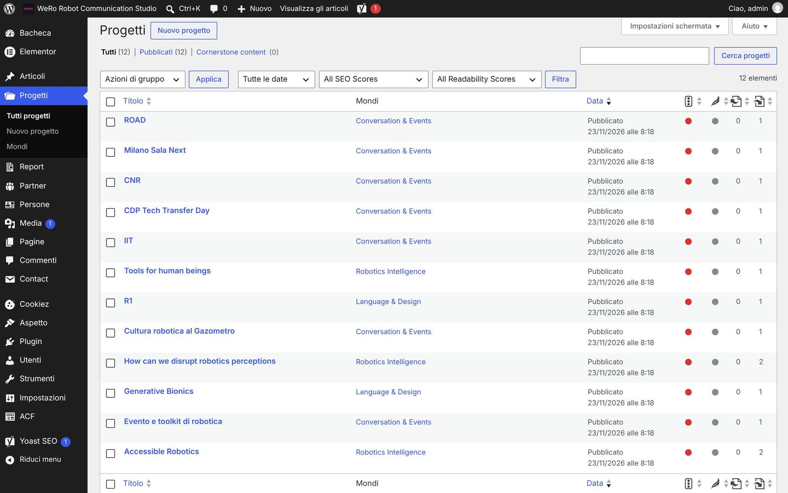

Ogni progetto ha:
- **Titolo** e **Riassunto** (pannello a destra): il riassunto è il sottotitolo della testata e la descrizione per Google.
- **Immagine in evidenza**: la copertina delle card e dei social. Se manca, compare una copertina di riserva col colore del mondo.
- **Mondo** (pannello a destra): Robotics Intelligence, Conversation & Events o Language & Design. Decide il colore e il filtro nella sfera.
- **Template** (pannello a destra › Template): il formato della pagina, uno tra **Articolo**, **Articolo complesso**, **Video** e **Podcast**.
- **Il testo** nell'editor, con i blocchi.
- **I campi** sotto l'editor, divisi in schede:

  | Scheda | Campi |
  |---|---|
  | Scheda | tipo (Evento, Video, Report…), anno, descrizione breve (per la sfera), “Con” (partner o cliente), icona della sfera, immagine della card |
  | Video o audio | link del video o dell'audio (file, YouTube, Vimeo, Spotify, SoundCloud, Apple Podcasts), oppure file caricato; copertina; durata |
  | Podcast | episodio, link Spotify, Apple Podcasts, YouTube, altra piattaforma |
  | Persone | ospiti e relatori collegati (dal tipo Persone) |

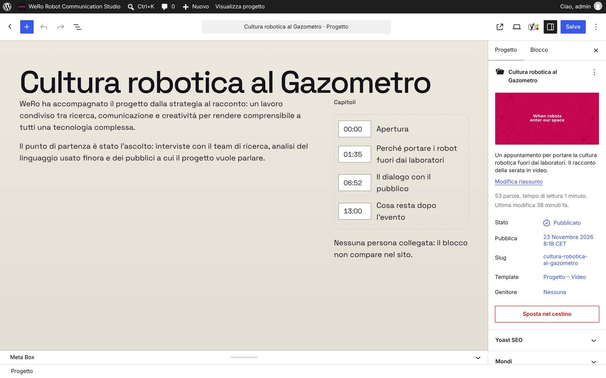

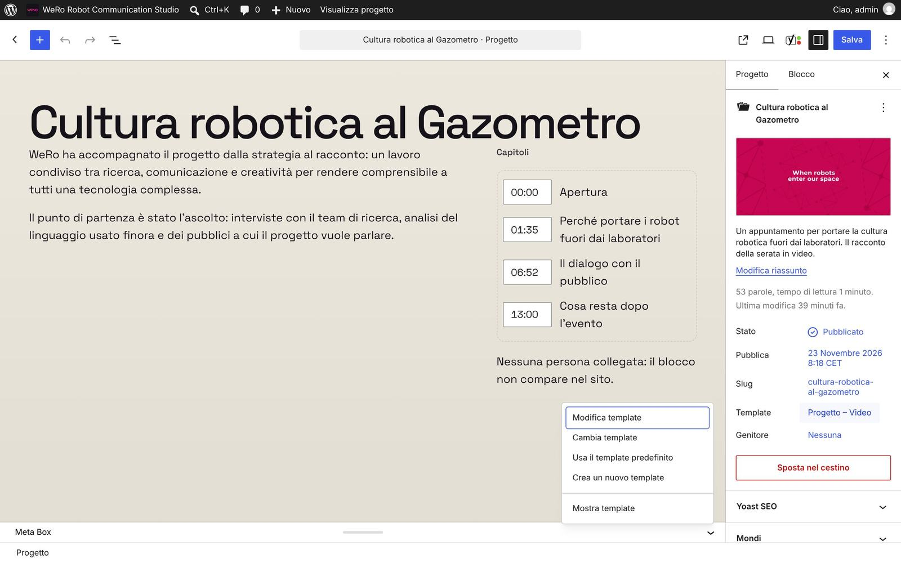

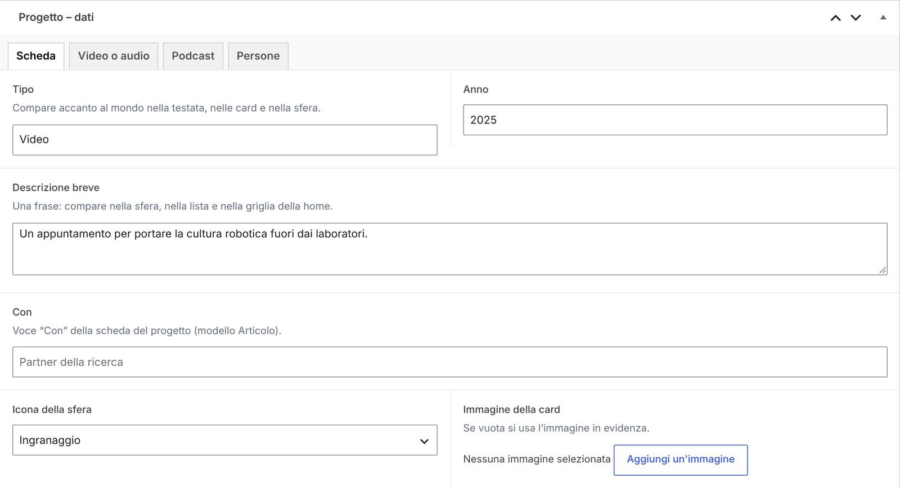

**Nuovo progetto**
1. Progetti › Aggiungi nuovo progetto.
2. Scegli il **contenuto di partenza** del formato (Articolo, Articolo complesso, Video, Podcast) dalla finestra che si apre.
3. Nel pannello a destra scegli lo stesso **Template**, il **Mondo** e l'**Immagine in evidenza**.
4. Compila i campi sotto l'editor e il **Riassunto**.
5. **Pubblica.** Il progetto compare subito nella sfera, nella griglia, in `/progetti/` e in “Altri progetti”.

**Video.** Nei progetti con template **Video** il video è la prima cosa della pagina, subito sotto il menu. Il link si inserisce nel campo **Link del video o dell'audio** (scheda “Video o audio”); la copertina è l'**immagine in evidenza** (o il campo “Copertina” della stessa scheda). Il video parte solo quando il visitatore preme play.

**Foto a scorrimento.** In fondo al testo di ogni progetto c'è una **Galleria** con lo stile “A scorrimento”, la stessa della home. Finché è vuota non compare sul sito.
1. Clicca la galleria nell'editor (o selezionala dalla Vista elenco).
2. **Aggiungi** › **Libreria media** (o **Carica** per foto nuove) e scegli le foto. Si possono scegliere più foto insieme.
3. Per cambiarne l'ordine trascinale; per toglierne una selezionala e premi Canc.
4. Ogni foto ha il suo **testo alternativo** (pannello a destra).

In un progetto creato prima di questa novità, la galleria si aggiunge con **+** › Pattern › **Progetto – Foto a scorrimento**.

**Ordine nella sfera e nella griglia:** campo **Ordine** nel pannello a destra (scheda Progetto). Più basso il numero, prima compare.

**Gli 8 progetti con testo segnaposto** hanno un avviso in testa alla pagina. Prima della messa online sostituisci il testo e togli il blocco dell'avviso.

### Report
**Report** nel menu. Campi: anno, stato (**Pubblicato** o **In arrivo**), testo e link del pulsante, descrizione, **PDF** (dalla Libreria media), progetto collegato e **immagine in evidenza** (la copertina nella timeline). La timeline della home li ordina per anno.

**Come si scaricano.** Il pulsante “Scarica il report” della timeline non scarica subito il PDF: porta alla pagina **Scarica i report** (`/scarica-report/`) con quel report già spuntato. Lì il visitatore lascia nome, email, azienda e ruolo, può spuntare anche gli altri report e, dopo l'invio:
- vede subito i link per scaricare i PDF scelti;
- riceve gli stessi link per email;
- il gestore del sito riceve un'email con chi ha scaricato e quali report.

**Aggiungere un report nuovo:** Report › Aggiungi nuovo › titolo, anno, stato **Pubblicato**, descrizione, **File PDF** e immagine in evidenza › Pubblica. Compare da solo nella timeline e nell'elenco del modulo: non serve toccare il modulo. Un report **In arrivo** o senza PDF compare nella timeline ma non nel modulo.

I due PDF caricati adesso sono **segnaposto**: sostituiscili con quelli definitivi dal campo “File PDF” di ciascun report.

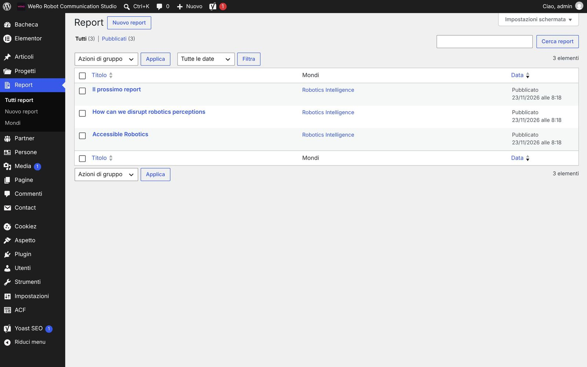

### Partner
**Partner** nel menu. Ogni partner è un logo della home. Campi:
- logo (PNG o WebP su fondo trasparente);
- tipo (**Business** o **Ricerca**);
- **Founder** (sì: compare tra i founder; no: nella riga curva dei collaboratori);
- altezza del logo, descrizione e sito (compaiono nella scheda che si apre al passaggio).

Per **aggiungere un logo** basta creare un Partner. L'ordine si cambia dal riquadro **Attributi dell'articolo › Ordinamento**, a destra. Per nascondere un logo senza cancellarlo, mettilo in **Bozza**.

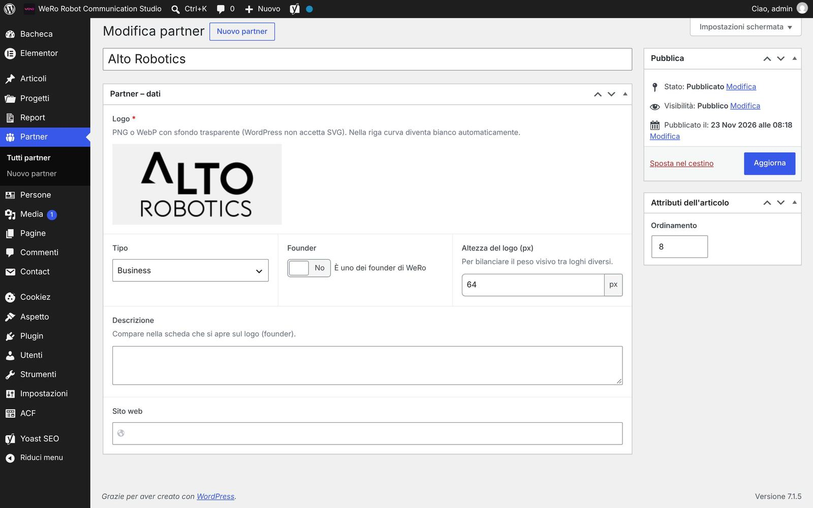

### Persone
**Persone** nel menu: nome (titolo), foto (immagine in evidenza), ruolo, ente. Si collegano ai progetti video e podcast dal campo **Persone** del progetto. Se un progetto non ha persone collegate, il blocco “Intervengono / Ospiti” non compare.

### Mondi
**Progetti › Mondi.** Sono tre: Robotics Intelligence, Conversation & Events, Language & Design. Si possono rinominare, ma non cancellare: la sfera e i colori dipendono da loro. Campi: stile del bollino e ordine.

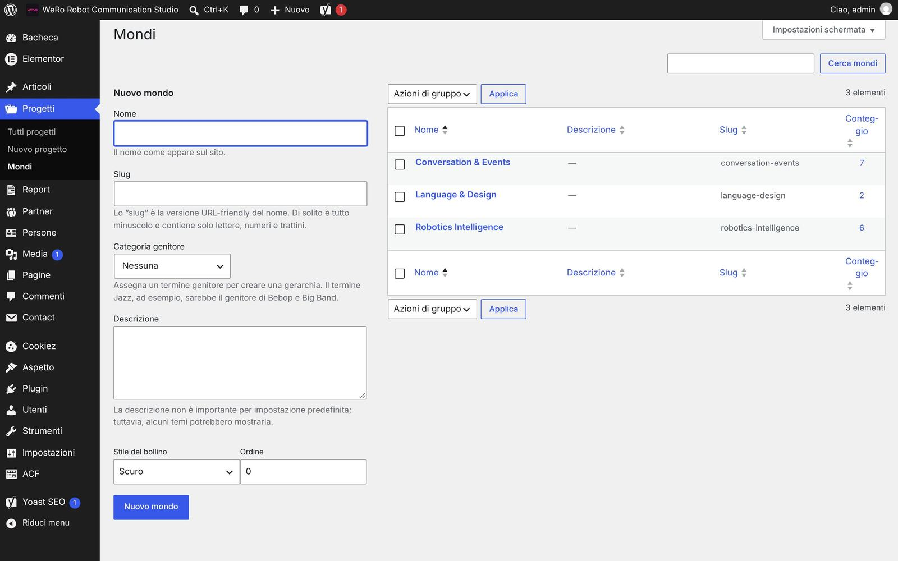

## 7. Impostazioni del sito

**Impostazioni › WeRo** (solo amministratori). Raccoglie i dati usati in più punti del sito.

| Sezione | Cosa contiene |
|---|---|
| Organizzazione | nome, descrizione, **email contatti**, **pagina LinkedIn**, testo del copyright (footer e dati per Google) |
| Joint venture | dati di 6.14 S.r.l. e Omnicom Advertising (founder nei dati per Google) |
| Aspetto | colori e font (sezione 5) |
| Animazioni | interruttore generale, intro del logo (e “solo alla prima visita”), sfondo a pixel, cursore, comparsa allo scroll, transizioni tra pagine |
| Moduli e funzioni | quale modulo CF7 usare per “Diventa partner”, emoji di WordPress |

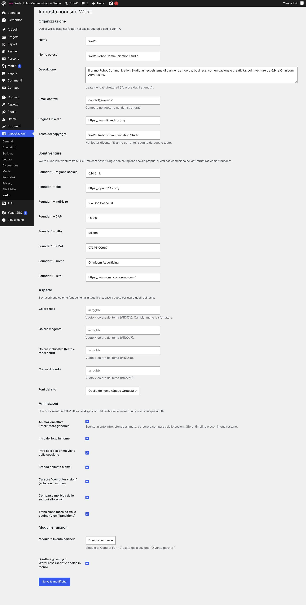

**Da completare:** l'indirizzo reale della pagina **LinkedIn**.

## 8. Yoast SEO

Yoast gestisce titoli, descrizioni, anteprime social, dati strutturati, sitemap e breadcrumb. È già configurato (vedi PLUGIN-IMPOSTAZIONI.md).

**Per ogni pagina o progetto**, nel riquadro **Yoast SEO** sotto l'editor:
1. **Frase chiave:** la parola o frase per cui la pagina deve farsi trovare.
2. **Anteprima di Google:** titolo e meta description. Se la description è vuota, Yoast usa il **Riassunto** del progetto.
3. **Social:** immagine e testi per LinkedIn e altri social. Se vuoti, usa l'immagine in evidenza.
4. Segui i suggerimenti verdi, arancio e rossi senza ossessione: contano soprattutto titolo, description e testo chiaro.

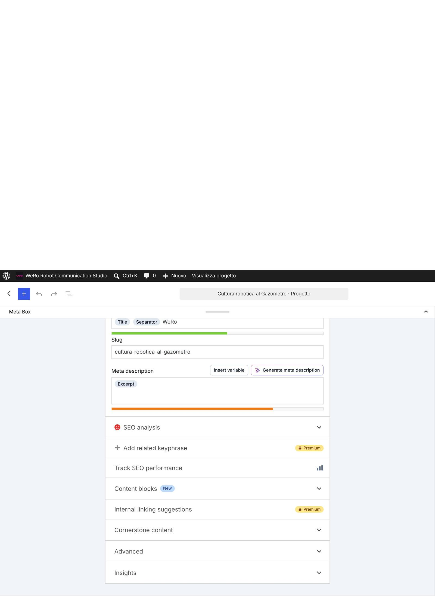

**Impostazioni generali** (Yoast SEO › Impostazioni): rappresentazione del sito, titoli di default, breadcrumb, llms.txt. Non serve toccarle.

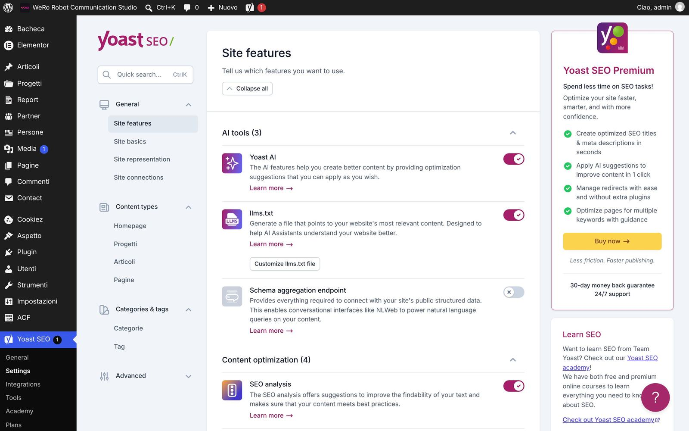

**Non usare** altri plugin SEO e non incollare codice di schema o meta nelle pagine: sono già gestiti.

## 9. Immagini

1. **Media › Aggiungi nuovo file multimediale**, oppure direttamente dal blocco Immagine con **Carica**.
2. Prima di caricare:
   - **formato:** JPG o WebP per le foto, PNG per i loghi con trasparenza;
   - **dimensioni:** al massimo 2400px sul lato lungo; WordPress crea da solo le versioni più piccole;
   - **nome del file** descrittivo, per esempio `cultura-robotica-gazometro.jpg`.
3. Compila sempre il **Testo alternativo**: descrive l'immagine a chi non la vede ed è utile per Google. Per le immagini solo decorative lascialo vuoto.
4. Image Optimizer (**Media › Image Optimizer**), una volta collegato, comprime e converte in WebP in automatico. Da **Media › Bulk Optimization** si ottimizzano in blocco le immagini già caricate.

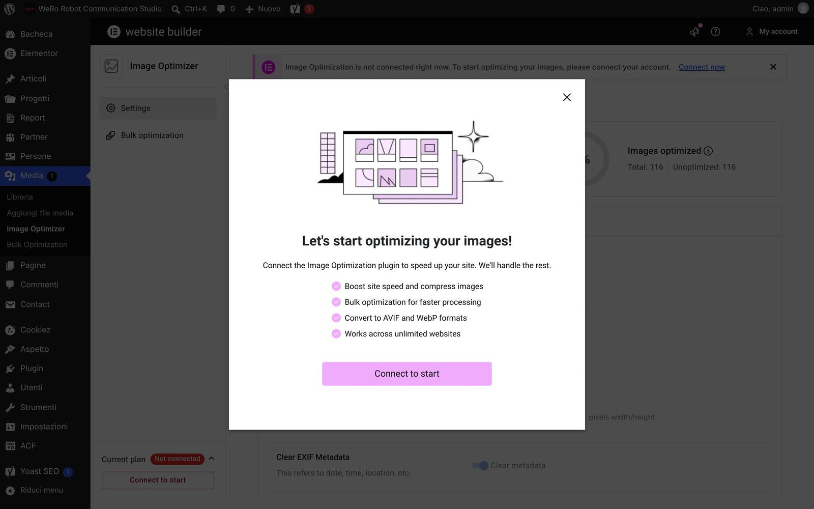

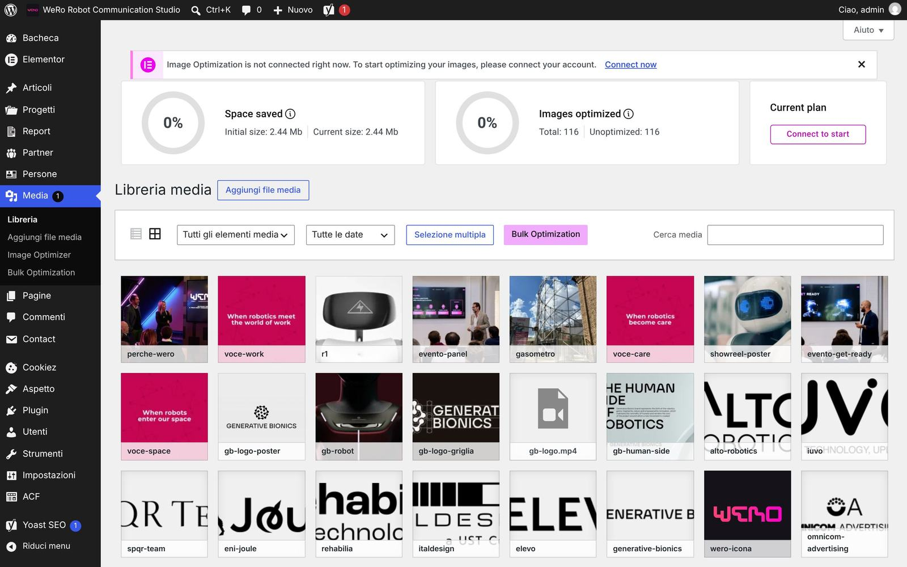

**Formati consigliati**
| Uso | Proporzione | Misura consigliata |
|---|---|---|
| Copertina progetto (card) | 4:3 | 1600×1200 |
| Immagine in evidenza / social | 1,91:1 | 1200×630 |
| Card Mondi | 4:3 | 1200×900 |
| Foto a scorrimento dei progetti | 3:2 (o 3:4 in verticale) | 1800×1200 |
| Copertina del video (immagine in evidenza dei progetti video) | 16:9 | 1920×1080 |
| Copertina dei report | 4:3 | 1200×900 |
| Logo partner | libera | almeno 400px di larghezza, fondo trasparente |
| Foto persone | 1:1 | 400×400 |

**SVG:** WordPress non accetta SVG nella Libreria media. Converti i loghi in PNG.

## 10. Modulo contatti ed email

I moduli sono in **Contact › Contact Forms**:
- **Diventa partner** (home, sezione partner);
- **Scarica i report** (pagina `/scarica-report/`). L'elenco dei report è il campo `[checkbox* report use_label_element default:get data:wero_reports]`: **non va cambiato**, si compila da solo con i Report pubblicati. Le sue email sono una al gestore (“Qualcuno ha scaricato un report”) e una a chi compila, con i link ai PDF (codice `[_wero_report_links]`).

I due moduli sono collegati al sito da **Impostazioni › WeRo › Moduli e funzioni**. Le schermate di Contact Form 7 possono essere in inglese finché WordPress non scarica la traduzione italiana: Form = Modulo, Mail = Email, Messages = Messaggi.

Se nell'elenco c'è anche **“Contact form 1”**, è il modulo di esempio che Contact Form 7 crea da solo: non è usato dal sito e si può cancellare.

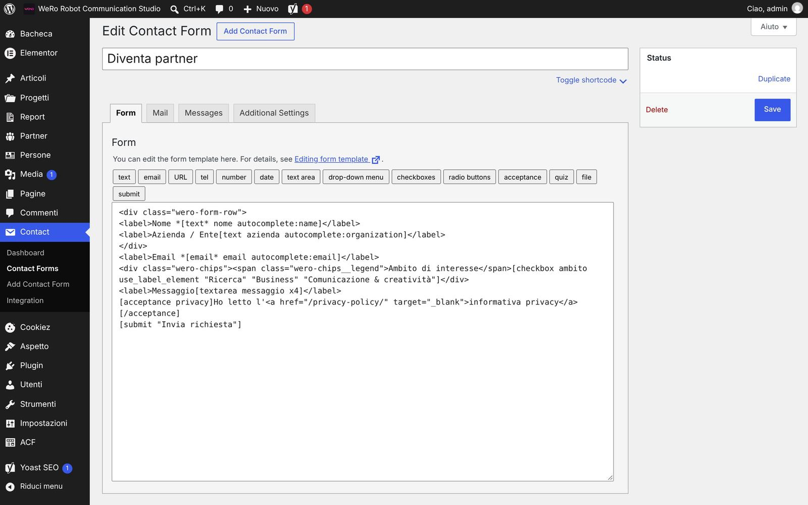

- **Scheda Modulo:** i campi. Per cambiare un'etichetta modifica il testo prima del codice tra parentesi quadre (`[text* nome]`), senza toccare il codice. Non togliere la casella **privacy**: è obbligatoria.
- **Scheda Mail:** le due email inviate a ogni richiesta.
  - **Mail 1** a `contact@we-ro.it`: riepilogo della richiesta, “Rispondi” scrive direttamente a chi ha compilato.
  - **Mail 2** a chi ha compilato: conferma e ringraziamento.

  Il corpo è in HTML con lo stile WeRo: cambia solo i testi tra i tag, e lascia come sono i codici tra parentesi quadre (`[nome]`, `[email]`…), che vengono sostituiti con i dati inviati.
- **Scheda Messaggi:** i testi che vede il visitatore (“Grazie! Ti ricontatteremo presto.”, errori…).

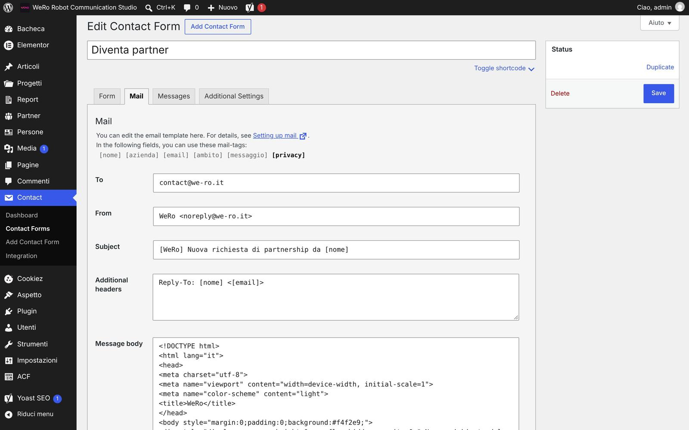

**Le email arrivano?** Le invia **Site Mailer**, collegato sul sito online.
1. **Impostazioni › Site Mailer › Email logs:** l'elenco di ogni email inviata con lo stato (inviata, consegnata, rimbalzata).
2. Se una conferma non è arrivata, controlla lì l'indirizzo e lo stato, poi chiedi alla persona di guardare nello spam.
3. Se nessuna email parte, controlla che Site Mailer risulti **collegato** e il dominio **verificato**.

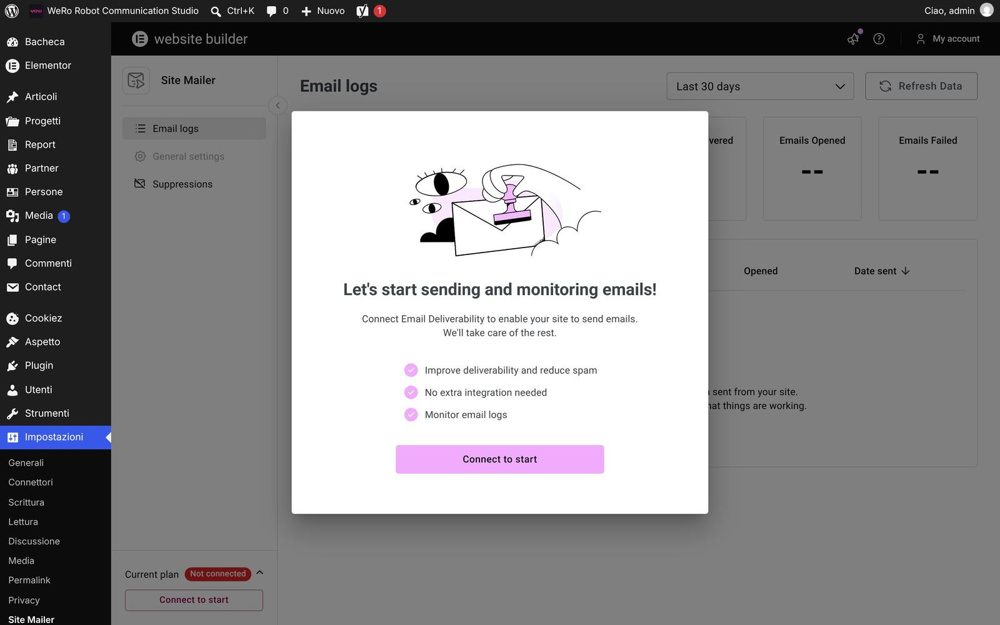

## 11. Cookie

Il banner dei cookie è gestito da Cookie Consent, voce **Cookiez** nel menu a sinistra, da collegare sul sito online (**Connect to start**). Le sezioni principali: **Design** (aspetto del banner), **Content** (testi), **Cookie management** (scansione e categorie), **Consent logs** (registro dei consensi).
- Il plugin scansiona il sito e assegna i cookie alle categorie: Necessari, Funzionali, Analitici, Pubblicitari.
- Il sito **non carica YouTube, Vimeo o Spotify finché il visitatore non clicca** il video: prima del clic non parte nessun cookie di terze parti.
- Se si aggiunge un servizio esterno (per esempio Google Analytics con Site Kit, o un nuovo video incorporato in modo diverso), rilancia la **scansione** e aggiorna la tabella nella **Cookie policy** (Pagine › Cookie policy).
- Testi legali (Privacy e Cookie policy): sono pagine normali in Pagine. Modificali solo con il consenso del titolare del trattamento (6.14 S.r.l.).

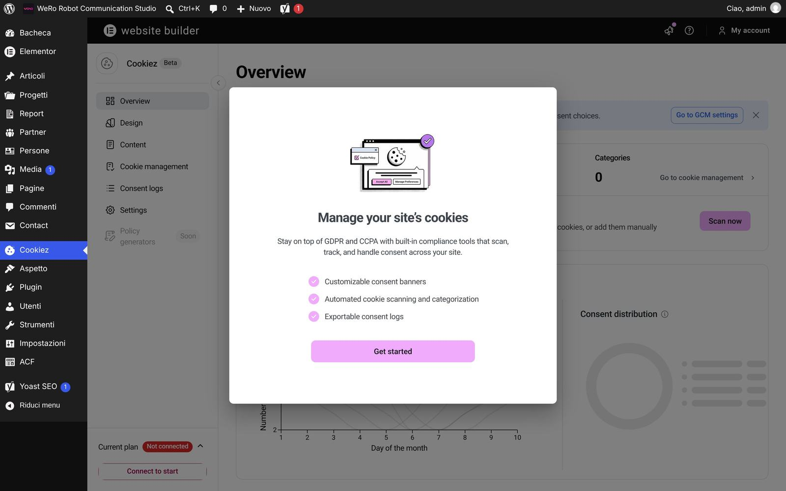

## 12. Cosa non fare

- **Non installare page builder** (Elementor e simili), **altri plugin SEO**, altri banner cookie o plugin SMTP. Sono tutti già coperti.
- **Non usare i blocchi HTML personalizzato, Shortcode o Classico.** Sono già nascosti; se ne servisse uno, chiedi allo sviluppatore.
- **Non cambiare tema.** Il tema WeRo e il plugin WeRo Core lavorano insieme.
- **Non disattivare WeRo Core:** spariscono sfera, timeline, loghi e i campi dei progetti. I contenuti restano, ma non si vedono.
- **Non modificare i gruppi di campi** in ACF › Gruppi di campi: le modifiche si perdono al prossimo aggiornamento.
- **Non cancellare i Mondi** e non cambiarne lo slug (`robotics-intelligence`, `conversation-events`, `language-design`): i link “Vedi i progetti” li usano.
- **Non usare colori fuori palette** o dimensioni di testo a mano: usa gli stili dei blocchi e i colori della palette.
- **Non caricare immagini enormi** (oltre 2400px o oltre 2 MB).
- **Non modificare i file** del tema o del plugin dalla bacheca (Aspetto › Editor dei file dei temi): le modifiche si perdono all'aggiornamento.
- **Non eliminare le pagine Privacy e Cookie policy**: sono collegate al footer, al modulo e al banner.

## 13. Aggiornamenti e backup

La procedura completa, passo per passo e con l'elenco dei controlli, è in **PROCEDURA-AGGIORNAMENTI.md**. Qui sotto il riassunto.

**Backup prima di tutto.** Usa il backup dell'hosting (giornaliero, con almeno 14 giorni di storico). Prima di ogni aggiornamento importante fanne uno a mano.

**Aggiornamenti di WordPress e dei plugin** (Bacheca › Aggiornamenti)
- Ogni 2 settimane circa, **dopo il backup**.
- Prima su uno **staging** (copia del sito), se l'hosting lo offre.
- Aggiorna uno alla volta: WordPress, poi Yoast, ACF, Contact Form 7, Site Mailer, Cookie Consent, Image Optimizer.
- Dopo ogni aggiornamento controlla velocemente:
  - la home (sfera, timeline, loghi);
  - un progetto video;
  - un invio di prova del modulo.

**Tema WeRo e plugin WeRo Core** non si aggiornano dalla bacheca. Le nuove versioni arrivano dallo sviluppatore come file zip: Plugin › Aggiungi nuovo › Carica plugin (o Aspetto › Temi › Aggiungi › Carica tema). WordPress chiede se sostituire la versione attuale: rispondi sì. I contenuti non vengono toccati.

**Requisiti del server:** WordPress 7.1 o più recente, PHP 8.3 o più recente.

## 14. Domande frequenti

**Ho modificato la home ma online non vedo la modifica.**
Controlla di aver cliccato **Salva**. Poi ricarica la pagina con `Ctrl+F5` (Mac `Cmd+Shift+R`). Se l'hosting ha una cache, svuotala dal suo pannello.

**Non riesco a spostare o cancellare una sezione della home.**
Gli Editor possono cambiare testi e immagini della home, non la sua struttura (D6). Serve un amministratore.

**Come cambio il video di un progetto?**
Apri il progetto › sotto l'editor, scheda **Video o audio** › campo **Link del video o dell'audio** › incolla il link (YouTube, Vimeo o file) › Aggiorna.

**Dove sono finite le Voci della home?**
Sono diventate tre progetti con template Video (“When robotics become care”, “When robotics meet the world of work”, “When robots enter our space”), in Progetti. Manca solo il link al video.

**Come aggiungo un report scaricabile?**
Report › Aggiungi nuovo, stato **Pubblicato** e **File PDF** caricato: compare da solo nella timeline e nel modulo “Scarica i report”.

**Come aggiungo un logo nella riga dei collaboratori?**
Partner › Aggiungi nuovo › titolo, logo, tipo (Business o Ricerca), “Founder” no › Pubblica.

**Un progetto non compare nella sfera.**
Deve essere **pubblicato** e avere un **Mondo**. Per la posizione controlla il campo **Ordine** nel pannello a destra.

**Come nascondo un progetto senza cancellarlo?**
Mettilo in **Bozza**: sparisce da sfera, griglia e archivio.

**Come spengo un'animazione** (intro, cursore, sfondo)?
Impostazioni › WeRo › Animazioni. Chi ha attivato “riduci movimento” sul proprio dispositivo non le vede comunque.

**Come cambio l'email dei contatti?**
Impostazioni › WeRo › Email contatti per footer e dati di Google. Poi Contact › Contact Forms › Diventa partner › scheda Mail: campo **A** della Mail 1 e Reply-To della Mail 2.

**Un video di YouTube non parte.**
Controlla che il link sia quello della pagina del video (`https://www.youtube.com/watch?v=…` o `https://youtu.be/…`) e che il video sia pubblico o “non in elenco”.

**Posso tradurre il sito in inglese?**
Testi del tema e del plugin sono già pronti per la traduzione. Per un sito bilingue serve un plugin multilingua: è un progetto a parte (D5).

**Chi chiamo se qualcosa si rompe?**
Prima guarda se c'è stato un aggiornamento appena fatto: in quel caso ripristina il backup. Poi contatta lo sviluppatore indicando pagina, ora e cosa stavi facendo, con uno screenshot.
